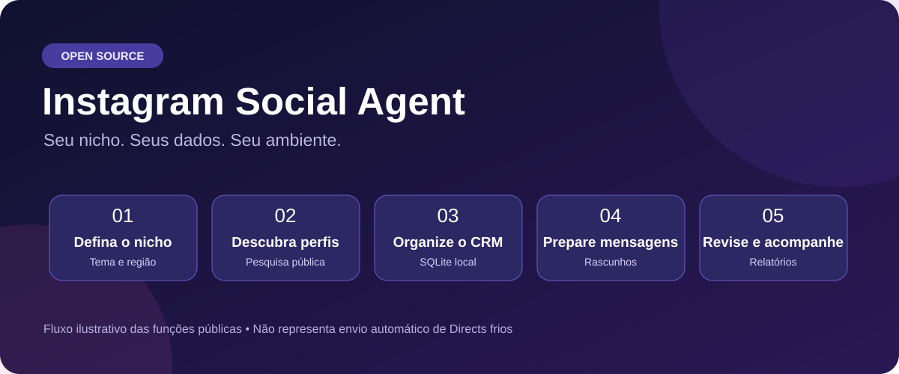
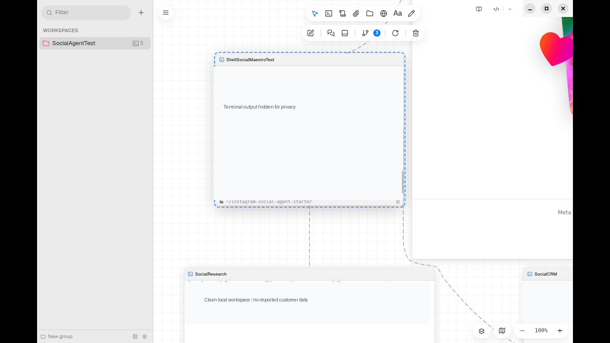

<div align="center">

# 🚀 Instagram Social Agent

### Transforme pesquisa de perfis em um fluxo organizado de prospecção.

**Escolha seu nicho · Pesquise perfis públicos · Organize no CRM · Prepare abordagens · Acompanhe resultados**


**[📦 Instalação](#instalação-em-3-passos--não-precisa-programar) · [🖥️ Prints reais](#-print-real-do-ambiente-de-testes) · [🧭 Como funciona](#-como-o-agente-funciona) · [⚙️ Configuração Maestro](MAESTRI-PROMPT.md)**

</div>



## 📸 Print real do ambiente de testes

A imagem abaixo foi capturada durante a validação em uma **máquina Linux isolada no Google Cloud**. Ela mostra o workspace do Maestri, o terminal supervisor, os terminais **SocialResearch** e **SocialCRM**, e o portal do Instagram. A saída dos terminais foi ocultada por privacidade.



> **Registro de teste:** a criação dos terminais por `maestri recruit`, o portal `maestri portal create`, a instalação Linux e quatro testes unitários foram confirmados. Os terminais do teste usaram o preset **Shell**, não agentes de IA autenticados. O print **não é demonstração de follows ou Directs enviados**.

## 🧭 Como o agente funciona

| Etapa | O que acontece | Estado |
|:--|:--|:--|
| 🎯 Público-alvo | Defina setor, nicho e região | Configurável |
| 🔎 Descoberta | Pesquisa links públicos com a chave de busca **do usuário** | Implementado; requer configuração |
| 🗂️ CRM local | Persiste candidatos, evita duplicações e organiza revisão | Implementado |
| ✉️ Mensagens | Gera textos para revisão, sem disparar contatos frios automaticamente | Implementado |
| 📊 Relatórios | Acompanha contatos e fila local | Implementado |
| 🧩 Maestri | Terminais e navegador em workspace independente | Provisionamento testado; requer sessão Maestro |
| 🔑 Instagram | Login na **própria conta** pelo portal | Tela de login testada; autenticação individual |
| 🤖 IA autônoma | Execução por Codex, Claude Code ou Antigravity | Depende de agente autenticado; ponta a ponta não validado |

**Privacidade:** não contém bases de contatos, cookies, sessões, credenciais ou caminhos de trabalho do desenvolvedor. Cada instalação cria seu próprio ambiente.

**Importante:** esta versão não implementa follow automático em escala nem Directs promocionais não solicitados; não há promessa de evitar bloqueios do Instagram. O atendimento pela API oficial depende de permissões e de conversas elegíveis.

---

# INSTALAÇÃO EM 3 PASSOS — NÃO PRECISA PROGRAMAR

> **Para Windows.** Cada pessoa cria seu próprio ambiente: não usamos os bancos, as contas ou as ferramentas particulares do desenvolvedor.

## PASSO 1 — Instalar e abrir o Maestri
1. Acesse **https://www.themaestri.app/pt-br/windows**.
2. Instale, abra o aplicativo e conecte **sua conta** de agente de IA (Codex, Claude Code ou Antigravity).
3. No Maestri, abra um terminal com papel **Maestro**. Você usará esse terminal no Passo 3.

## PASSO 2 — Instalar o Instagram Social Agent pelo PowerShell
1. No Windows, clique em **Iniciar** e procure **PowerShell**.
2. Abra o PowerShell normal (não precisa executar como administrador).
3. Copie e cole o comando abaixo e pressione **Enter**:

```powershell
& ([scriptblock]::Create((Invoke-RestMethod 'https://raw.githubusercontent.com/Gmdrones/instagram-social-agent-starter/main/bootstrap.ps1')))
```

Esse comando baixa os arquivos públicos do repositório e executa o instalador local. **Confira o código antes de executar**, pois o comando obtém um script remoto. Para revisar ou instalar sem executá-lo diretamente, abra [bootstrap.ps1](./bootstrap.ps1), baixe o repositório como ZIP e execute o arquivo localmente.

**O que acontece:** o instalador cria a pasta `%USERPROFILE%\InstagramSocialAgent`, os programas locais e o banco SQLite **novo** dentro de `data`. Ele não importa contatos, cookies, senhas ou bases de terceiros.

## PASSO 3 — Deixar o Maestro preparar os agentes
1. Abra [**MAESTRI-PROMPT.md**](./MAESTRI-PROMPT.md).
2. Clique em **Copy raw file** (ou selecione e copie todo o texto).
3. Volte ao Maestri e **cole o texto dentro do terminal Maestro**, não no PowerShell. Pressione **Enter**.
4. O Maestro tentará criar os terminais **Social Pesquisa**, **Social CRM** e **Social Navegador**, usando a sua conta de IA e o diretório instalado. Você não precisa digitar individualmente os comandos de cada terminal.
5. Quando o portal do Instagram abrir, **faça login você mesmo**, na sua própria conta. Não forneça senha nem código 2FA ao agente.
6. Responda apenas as perguntas sobre **empresa, público, região, mensagem e horários**. Para pesquisas automatizadas de sites públicos será necessária uma chave de pesquisa própria (veja mais abaixo).

**O que é automático e o que ainda não é?** O PowerShell instala a aplicação e prepara o prompt. A criação real dos agentes depende do Maestro e dos presets disponíveis; o prompt instrui a verificar o resultado. Login, permissões Meta e escolha do público exigem participação do usuário. O navegador não torna o envio de Directs automaticamente autorizado.

## Precisa configurar a API da Meta?
**Só para o atendimento via API oficial.** A pesquisa por páginas públicas e a preparação de abordagens são independentes da Meta, mas exigem fonte de pesquisa permitida. Para receber eventos e responder pelo Instagram Messaging API é necessário uma conta profissional elegível, app Meta com permissões apropriadas, token e webhook HTTPS configurado pelo próprio usuário.

## Como saber se funcionou?
No terminal Maestro, peça **“Verifique os terminais e execute o teste de instalação do Social Agent. Mostre o resultado real de maestri list, service.cmd status e social.cmd draft.”** O agente deve identificar qualquer etapa faltante; não deve dizer que o envio de mensagens ou a prospecção estão ativos sem teste comprovado.

**Limite importante:** a versão pública ainda não automatiza follows de perfis arbitrários nem envia Directs promocionais não solicitados. Não há garantia contra restrições da plataforma.

---

# Instagram Social Agent

Open-source local business assistant for Instagram professional accounts, compatible with **Maestri**, **Codex**, **Claude Code** and **Antigravity**.

## Current implementation

- PowerShell installers for the local assistant; separate official Maestri installer link
- Local SQLite CRM for contacts and lead records, generated on each user's own computer (no publisher database uploaded or connected)
- Configurable niche/region discovery through the user's own public-search API key, with local candidate review and message drafting
- Customizable business, audience, location and message templates
- Official Meta Instagram API identity connectivity check
- **Webhook server with signed event verification**, duplicate event protection and inbound contact history
- Reply drafting and a review/approval queue
- Official API dispatch of individually approved replies from eligible inbound threads
- Activity reports from stored incoming events and confirmed outgoing API sends
- Unit tests; no compulsory paid services

**Not yet provided:** one-click Maestri terminal provisioning, automated discovery across Instagram profiles, arbitrary follow actions, unsolicited outreach, unattended automatic messaging, production-grade hosted HTTPS webhook deployment, or proof of end-to-end delivery in a live Meta account. Please do not interpret `setup --auto-reply` as enabling automatic sends. The software cannot guarantee no account restrictions.

## Windows installation

Prerequisites: Python 3.10+, PowerShell 5.1+, an Instagram Professional account, and a Meta developer app for messaging features.

1. Install Maestri **separately from its official website** using:
```powershell
powershell -NoProfile -ExecutionPolicy Bypass -File .\install-maestri.ps1 -OpenOfficialPage
```
2. Install the Social Agent:
```powershell
powershell -NoProfile -ExecutionPolicy Bypass -File .\install.ps1
powershell -NoProfile -ExecutionPolicy Bypass -File .\connect-maestri.ps1
```
3. Open `%USERPROFILE%\InstagramSocialAgent` in a Codex, Claude Code or Antigravity terminal within Maestri. This part is manual in the current version.
4. Configure your own business:
```powershell
& "$HOME\InstagramSocialAgent\service.cmd" setup --company "Your Business" --niche "your audience" --region "your city" --message "Hello! Thanks for contacting {company}. How can we help?"
& "$HOME\InstagramSocialAgent\service.cmd" status
& "$HOME\InstagramSocialAgent\social.cmd" draft
```
Templates support `{company}`, `{niche}` and `{website}`.

## Meta API connection (required for actual replies)

1. Create your Meta app at https://developers.facebook.com/ and connect an eligible Instagram Professional account.
2. Configure Instagram messaging permissions, app review if applicable, and the subscribed webhook fields as required by the current official documentation.
3. Store `META_ACCESS_TOKEN`, `META_IG_USER_ID`, `META_APP_SECRET` and `META_VERIFY_TOKEN` **in your own secure environment**. Never commit them or paste them into issues.
4. Run locally:
```powershell
& "$HOME\InstagramSocialAgent\service.cmd" serve
```
5. Provide a secure public **HTTPS reverse proxy** forwarding `/webhook` to `127.0.0.1:8765`. This repository does not configure a public domain or proxy.
6. Configure Meta webhook verification URL and token in the Meta app, then test with a real incoming message from an eligible conversation.

The webhook validates `X-Hub-Signature-256` using your app secret. Each accepted inbound message is deduplicated, stored in a local CRM and queued as a **draft**.

Review and send an eligible reply:
```powershell
& "$HOME\InstagramSocialAgent\service.cmd" status
& "$HOME\InstagramSocialAgent\service.cmd" approve 1
& "$HOME\InstagramSocialAgent\service.cmd" dispatch 1
& "$HOME\InstagramSocialAgent\service.cmd" report
```
Dispatch only succeeds if Meta accepts the request and returns a message ID. The recipient must meet platform messaging requirements and consent rules. Receiving an event does not by itself guarantee ongoing messaging eligibility.

## Discover prospects in your chosen niche (independent installation)

The user chooses an audience and location, such as drone pilots in Brazil, shops in Lisbon, or dentists in São Paulo. Configure a **personal Brave Search API key** (Brave Search may have usage charges/limits). Discovery uses indexed public web results and collects Instagram profile links for review. All results are stored exclusively in the user’s local `InstagramSocialAgent/data/` folder. No publisher database, API account, Maestri workspace or Instagram profile is accessed.

```powershell
$env:BRAVE_SEARCH_API_KEY = 'YOUR_OWN_SEARCH_API_KEY'
& "$HOME\InstagramSocialAgent\discover.cmd" discover --niche "pilotos de drone" --region "Brasil"
& "$HOME\InstagramSocialAgent\discover.cmd" list
& "$HOME\InstagramSocialAgent\discover.cmd" plan
```

Candidates may be inaccurate and must be reviewed. `plan` prepares a message for each profile but **does not follow accounts or send unsolicited Directs**. Instagram’s official business messaging API requires eligible user-initiated conversations for replies. There is no general official API endpoint for following arbitrary profiles. See [Meta Instagram API docs](https://www.postman.com/meta/instagram/documentation/6yqw8pt/instagram-api).

## Lead workflow

```powershell
& "$HOME\InstagramSocialAgent\social.cmd" lead example_brand --niche "photography" --source "user-provided public website"
& "$HOME\InstagramSocialAgent\social.cmd" list
```

The local CRM can store leads supplied by the operator. **It does not scrape Instagram, automatically follow profiles, or initiate unsolicited DMs.** Planned compliant discovery and qualification should operate on permitted, accessible sources and keep adequate provenance.

## Security and responsible use

- No credentials or personal workspace files included.
- No guaranteed prevention of Instagram restrictions.
- Official supported Meta endpoints only. No scraping, stealth browser outreach or account-limit bypasses.
- Do not expose `/webhook` without signature verification and HTTPS; run locally behind a properly secured public endpoint.
- The server is a reference implementation. For public production hosting, add operational monitoring, token rotation, backups and retry/queue resilience.
- Follow Meta app review, messaging windows, applicable privacy rules and local law.

## Contribute and test

```sh
python -m unittest discover -s tests -v
```

MIT licensed community project. Suggestions and tested contributions are welcome; see `CONTRIBUTING.md` and `SECURITY.md`.

## Maestri browser and agent workspace setup

After installing the app, run:

```powershell
powershell -NoProfile -ExecutionPolicy Bypass -File .\setup-maestri-workspace.ps1 -OpenInstagram
```

This creates `MAESTRI-BOOTSTRAP.md` for configuring a **new user-owned** workspace: a research terminal, a CRM terminal and a browser portal. In Maestri, the native `maestri recruit` command is **Maestro-only** and must be issued from an authenticated Maestro session; therefore the current installer **cannot automatically create the terminals or log into Instagram**. The user signs in directly in their own portal and selects their own AI provider. Never distribute browser profiles or existing cookies. The public browser interface is not an unrestricted outbound messaging API.
